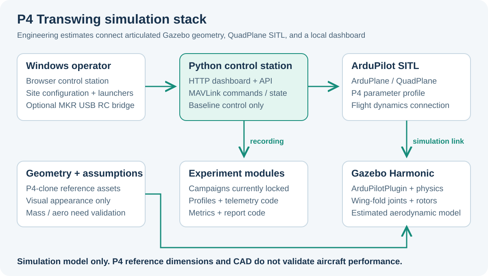

# P4 Transwing VTOL Simulation

An articulated Transwing aircraft model, ArduPlane QuadPlane SITL, and a local browser control station for studying VTOL-to-fixed-wing transition.

[English](#english) | [Tiếng Việt](#tieng-viet)



<a id="english"></a>

## English

This project models a PteroDynamics P4-inspired Transwing: two wing panels fold around mirrored oblique hinges, carrying the rotors and control surfaces between hover and cruise configurations. Gazebo Harmonic provides the articulated model and estimated physics; ArduPlane QuadPlane SITL supplies flight control; a MiniHawk-derived control station manages the stack and MAVLink operations.

**The aircraft is a surrogate with engineering estimates, not a validated P4 digital twin.** Third-party P4-clone assets support visualization and geometric measurements. Mass distribution, inertia, aerodynamic coefficients, rotor calibration, and transition settings remain simulation assumptions. This project is not affiliated with PteroDynamics.

### Current scope

| Component | Included behavior |
| --- | --- |
| Aircraft model | Textured body, folding wing/rotor assemblies, four propellers, four ailerons, two ruddervators |
| Physics | Estimated lift/drag, inertias, rotor forces, collision shapes, IMU/NavSat/pressure sensors |
| SITL integration | Official `ardupilot_gazebo` JSON plugin, Quad-X hover, shared MotorTilt output, mirrored surface mixing |
| Control station | Process management, MAVLink state/actions, waypoint missions, supervised transition, DataFlash access |
| Worlds | Light baseline plus optional visual city scenery; separate articulation and open-loop flight worlds |
| Optional RC input | FlySky receiver -> MKR WiFi 1010 -> USB -> HTTP bridge -> MAVLink RC override |
| Experiment code | Schemas, monitoring, metrics, energy/fault/wind modules and tests; campaigns remain locked |

Only the **zero-wind, zero-added-payload `baseline`** case is enabled for stack startup. Live weather and payload sweeps are locked pending aerodynamic identification. `Simulation/experiments/cli.py` currently prints requests for `run`, `list`, and `compare`; it does not execute those operations.

### Repository map

| Path | Purpose |
| --- | --- |
| [Simulation/SETUP.md](Simulation/SETUP.md) | Detailed Windows/WSL installation, launch, recovery, and remote-machine guide |
| [Simulation/control_station](Simulation/control_station) | Python HTTP/MAVLink backend and static browser interface |
| [Simulation/gazebo/models/p4_transwing_ardupilot](Simulation/gazebo/models/p4_transwing_ardupilot) | Main SITL-connected model |
| [Simulation/gazebo/models/p4_transwing_estimated](Simulation/gazebo/models/p4_transwing_estimated) | Asset-based estimated model |
| [Simulation/gazebo/worlds](Simulation/gazebo/worlds) | SITL, scenery, articulation, and flight worlds |
| [Simulation/ardupilot](Simulation/ardupilot) | SITL launcher, parameters, missions, isolated runtime state |
| [Simulation/config](Simulation/config) | Compatibility record, site policy, source/estimate ledger |
| [Simulation/tools](Simulation/tools) | Installer, preflight, RC bridge, and remote synchronization helpers |
| [Simulation/experiments](Simulation/experiments) | Experimental analysis modules and tests |
| [MCU/Controller/Controller.ino](MCU/Controller/Controller.ino) | RC-only MKR iBUS-to-USB sketch |
| [Plan](Plan) | Model assumptions, reference plan, scenery, and RC wiring notes |
| [Ref/P4_clone](Ref/P4_clone) | Third-party source geometry in several 3D formats |

### Supported environment

The launch workflow targets **Windows 11 + WSL2/WSLg**, with Ubuntu 22.04 or 24.04 and **Gazebo Harmonic / Gazebo Sim 8.x**. Python, MAVProxy, ArduPlane SITL, and the Gazebo ArduPilot plugin run in WSL; the browser and optional Mission Planner run on Windows.

The repository's [compatibility record](Simulation/config/compatibility.json) lists this previously tested environment:

| Component | Recorded version |
| --- | --- |
| Ubuntu | 22.04 |
| Gazebo Sim | 8.14.0 |
| ArduPilot | `4f50f1997fec263e648119402991beda1071bc7c` |
| `ardupilot_gazebo` | `082a0fe231f6e63bc8d1598f1cba461d9e2ea7f5` |
| Python | 3.10.12 |
| pymavlink / MAVProxy | 2.4.49 / 1.8.74 |

These are the checked-in compatibility baseline, not a claim that this documentation edit reran the simulator. Preflight treats a Gazebo major-version mismatch as an error and commit/package-version differences as warnings according to the compatibility policy.

### Install on a new WSL environment

Clone the repository to a Windows-accessible directory, initialize the Ubuntu distro, and check it from PowerShell:

```powershell
git clone https://github.com/TuanLinh05/P4-Transwing-VTOL-Sim.git
cd P4-Transwing-VTOL-Sim
wsl.exe --list --verbose
```

In Ubuntu WSL, move to the clone's actual mounted path:

```bash
cd "/mnt/d/your-projects/P4-Transwing-VTOL-Sim"
less Simulation/tools/install_wsl_dependencies.sh
bash Simulation/tools/install_wsl_dependencies.sh --yes
```

The installer uses `sudo`, `apt`, and network downloads. It installs Gazebo Harmonic, clones the recorded ArduPilot/plugin commits, builds Plane SITL and `libArduPilotPlugin.so`, then runs deep preflight. It refuses to modify existing target source directories, normally `~/ardupilot` and `~/ardupilot_gazebo`.

If you already maintain those projects elsewhere, configure their WSL paths instead of rerunning the installer:

```bash
export P4_ARDUPILOT_HOME="/your/path/ardupilot"
export P4_ARDUPILOT_GAZEBO_HOME="/your/path/ardupilot_gazebo"
bash Simulation/tools/preflight_wsl.sh --deep
```

Keep those environment values available to the session that starts the stack. See [SETUP.md](Simulation/SETUP.md) for installation details and environment overrides.

### Launch the baseline

From PowerShell at the repository root:

```powershell
.\P4-Transwing-Preflight.cmd -Deep
.\P4-Transwing-Control-Station.cmd
```

For multiple Ubuntu distros, select one before launching:

```powershell
$env:P4_TRANSWING_WSL_DISTRO = "Ubuntu-24.04"
.\P4-Transwing-Control-Station.cmd
```

The launcher discovers the repository path, checks dependencies/models/ports, starts the backend, and opens [the local dashboard](http://127.0.0.1:8765). Select `baseline`, press **START SIMULATION**, and wait for Gazebo, SITL, and MAVLink readiness. The model starts **DISARMED**.

The default launcher uses software rendering. Use `P4-Transwing-Control-Station-GPU.cmd` when the WSL graphics environment supports it. Mission Planner is optional; standard installs can be discovered automatically. A portable installation can be selected with `P4_TRANSWING_MISSION_PLANNER` as described in the setup guide.

### Simulation operation

The existing baseline guide uses this sequence:

1. While DISARMED, inspect rotor, fold-joint, aileron, and V-tail directions and review PreArm/GPS/attitude state.
2. Use QLOITER takeoff to about 30 m and allow the aircraft to settle before requesting transition.
3. Use **CHUYỂN CÁNH BẰNG** for the supervised fixed-wing transition. The backend uses FBWB and temporary RC3 `1750`, then returns to cruise RC3 `1470` after ArduPilot reports completion.
4. Review the transition status; **ABORT -> QLOITER** requests return to VTOL. Use **QLAND** for vertical landing.
5. Finish with **STOP STACK**.

The transition flow checks state, altitude, and attitude and can request a fallback. These are safeguards for the surrogate model, not real-aircraft operating limits. ARM, takeoff, and AUTO actions use the dashboard's confirmation flow. Closing the browser tab **does not stop** Gazebo/SITL; reopen the dashboard and use STOP STACK.

### Manual stack and diagnostic commands

For separate WSL terminals, run from the repository root:

```bash
# Terminal 1: Gazebo server
bash Simulation/gazebo/run_p4_ardupilot_server_wsl.sh

# Terminal 2: Gazebo GUI
bash Simulation/gazebo/run_p4_gui_wsl.sh

# Terminal 3: ArduPlane SITL
bash Simulation/ardupilot/run_p4_sitl_wsl.sh
```

Add `--wipe` to the SITL launcher only when you intend to reset its simulated EEPROM and reload the parameter profile. State is isolated under `Simulation/ardupilot/sitl_state` by default. Manual SITL adds the dashboard output only when `P4_TRANSWING_EXTRA_MAVLINK_OUT` is set; the managed stack sets it to `127.0.0.1:14551`.

To start the backend directly in WSL, use its wrapper:

```bash
bash Simulation/control_station/start_control_station_wsl.sh
```

The wrapper runs the server as `python3 -m Simulation.control_station.server` from the repo root. Running `server.py` by file path can break top-level `Simulation` imports.

For a window that fails to appear over RDP/WSLg, inspect the diagnosis output:

```bash
bash Simulation/tools/diagnose_remote_wsl.sh
```

### Ports, state, and Home

| Endpoint | Role |
| --- | --- |
| TCP `127.0.0.1:8765` | Default browser dashboard and HTTP API |
| UDP `9002` | Gazebo/ArduPlane JSON flight-dynamics link |
| TCP `5760` | ArduPlane MAVLink connection used by MAVProxy |
| UDP `14550` | Optional Mission Planner output |
| UDP `14551` | Dedicated control-station MAVLink input |

The default API binds to loopback. Custom non-loopback binding is subject to the backend's separate request-authentication policy. Launcher logs are written to `%LOCALAPPDATA%\P4 Transwing\control-station.log` and `control-station-error.log`; SITL EEPROM/DataFlash data stay in the dedicated SITL state directory.

[site.json](Simulation/config/site.json) sets Home to `10.772100, 106.657900`, altitude 10 m, and mission policy to 500 m radius, 150 m maximum relative altitude, and 100 items. This is the configured HCMUT simulation site. Changing it requires keeping the world `<spherical_coordinates>`, SITL Home value, and absolute mission coordinates consistent; the JSON is not automatically propagated to every asset.

### Optional FlySky USB input

The bridge reads **RC commands only**; there is no telemetry return to the transmitter and no WiFi transport in the sketch.

| Connection | Wiring / behavior |
| --- | --- |
| FS-iA6B iBUS-SERVO signal | MKR WiFi 1010 D13, `Serial1` RX |
| Receiver GND | MKR GND |
| MKR USB | Windows PC |
| iBUS / USB setting | 115200 baud; sketch emits a frame every 10 ms |

Confirm iBUS signal compatibility with the MKR's 3.3 V logic. The SENS port and D0/D1 are unused. The sketch forwards ten channels with sequence, timestamp, status flags, and CRC-16/CCITT-FALSE in `P4RC/1` frames; an iBUS timeout at 150 ms substitutes safe channel values.

With the appropriate sketch already on the board, install `pyserial`, close any Serial Monitor holding the port, and run:

```powershell
py -3 -m pip install pyserial
py -3 Simulation\tools\bridge_mkr_usb.py --port COM5
```

Replace `COM5` with the actual port. The bridge forwards the latest state rather than replaying a backlog. CH1-4 are flight axes; CH7-9 are guarded arm/QRTL/mode switches handled by the control station; remaining channels are displayed/spare. The dashboard requires explicit radio authority. See [the RC bridge guide](Plan/MKR_WIFI_1010_IBUS_USB_CONTROL_BRIDGE.md) for full channel mapping and the PowerShell bridge alternative.

### Model limits, checks, and credits

- Published aircraft values, presentation evidence, asset measurements, and estimates are separated in [p4_reference.json](Simulation/config/p4_reference.json) and [Plan.md](Plan/Plan.md).
- The measured asset fold travel is about 2.05943 rad / 118 degrees; actuator feedback, homing, and fault monitoring are represented by synchronized revolute joints.
- The standard tilt-quad surrogate does not yet deactivate one propulsor pair during fixed-wing cruise. Rotor coefficients and center-of-gravity adjustments are simulation calibrations.
- Scenery assets are visual-only and do not provide obstacle collision or a validated navigation environment.
- Existing verification commands include `python3 -m unittest discover -s Simulation -p "test_*.py" -t .` and the DISARMED stack check `bash Simulation/gazebo/smoke_test_p4_ardupilot_wsl.sh`. Flight smoke scripts are separate and can arm the simulated aircraft; read them before use.

Read [P4_ESTIMATION_NOTES.md](Simulation/gazebo/P4_ESTIMATION_NOTES.md) and [P4_PARAM_NOTES.md](Simulation/ardupilot/P4_PARAM_NOTES.md) for the actual modeling assumptions and parameter rationale.

Credits: [ArduPilot](https://github.com/ArduPilot/ardupilot), [ardupilot_gazebo](https://github.com/ArduPilot/ardupilot_gazebo), Gazebo, and the **MiniHawk VTOL simulation dashboard**, from which the control station was adapted. `Ref/P4_clone` contains third-party P4-clone CAD/mesh assets; preserve their provenance when reusing them. No single top-level project license is included; component notices remain applicable. Author: [Vu Tuan Linh](https://github.com/TuanLinh05), HCMUT.

<a id="tieng-viet"></a>

## Tiếng Việt

Repo mô phỏng máy bay Transwing lấy cảm hứng từ PteroDynamics P4. Hai cánh gập quanh bản lề xiên đối xứng, mang theo rotor và mặt điều khiển khi đổi giữa VTOL và bay cánh bằng. Gazebo Harmonic mô phỏng hình học/vật lý; ArduPlane QuadPlane SITL điều khiển; dashboard chuyển thể từ **MiniHawk** quản lý tiến trình và MAVLink.

**Đây là mô hình surrogate có ước lượng kỹ thuật, chưa phải digital twin P4 đã kiểm chứng.** CAD/mesh bên thứ ba dùng cho hiển thị và đo hình học. Khối lượng, quán tính, khí động, rotor và chuyển tiếp còn cần nhận dạng/đo đạc. Dự án không liên kết với PteroDynamics.

### Cài đặt và chạy

Môi trường mục tiêu: Windows 11, WSL2/WSLg, Ubuntu 22.04 hoặc 24.04, Gazebo Sim 8.x. Bảng phiên bản đã ghi nhận nằm ở phần tiếng Anh và [compatibility.json](Simulation/config/compatibility.json).

1. Clone repo, kiểm tra Ubuntu bằng `wsl.exe --list --verbose`.
2. Trong Ubuntu WSL, chuyển đến đường dẫn clone, đọc script rồi chạy `bash Simulation/tools/install_wsl_dependencies.sh --yes`. Script dùng sudo/apt/mạng và từ chối sửa thư mục ArduPilot/plugin đã tồn tại.
3. Từ PowerShell tại gốc repo, chạy `.\P4-Transwing-Preflight.cmd -Deep`.
4. Khi preflight đạt, chạy `.\P4-Transwing-Control-Station.cmd` và mở `http://127.0.0.1:8765`.
5. Chọn `baseline`, nhấn START SIMULATION, chờ Gazebo/SITL/MAVLink sẵn sàng. Máy bay bắt đầu DISARMED.

Chỉ baseline không gió/không payload thêm được mở. Live weather và campaign payload vẫn khóa; CLI experiment hiện chỉ in yêu cầu, chưa chạy thử nghiệm. Nếu đã có ArduPilot/plugin riêng, đặt `P4_ARDUPILOT_HOME` và `P4_ARDUPILOT_GAZEBO_HOME` trong WSL theo phần tiếng Anh.

### Vận hành mô phỏng

Kiểm tra chiều rotor/cánh/mặt điều khiển khi DISARMED. Luồng baseline hướng dẫn cất cánh QLOITER khoảng 30 m, chờ ổn định rồi nhấn **CHUYỂN CÁNH BẰNG**. Dashboard dùng FBWB và RC3 1750 tạm thời, giảm về 1470 sau khi ArduPilot báo hoàn tất; có giám sát để yêu cầu quay về QLOITER khi vượt điều kiện.

Dùng **ABORT -> QLOITER** để trở lại VTOL, QLAND để hạ thẳng đứng và STOP STACK để kết thúc. Đóng tab không dừng mô phỏng. Các giá trị/giới hạn này phục vụ mô hình ước lượng, không dùng làm giới hạn khai thác P4 thật.

Các lệnh chạy thủ công, cổng mạng và bảng nguồn ở phần tiếng Anh áp dụng cho cùng project. Thêm `--wipe` chỉ khi muốn reset EEPROM SITL. Home/policy ở [site.json](Simulation/config/site.json) phải được đồng bộ với world, SITL và waypoint tuyệt đối khi đổi địa điểm.

### RC, log và tài liệu

Cầu nối tùy chọn: FS-iA6B iBUS-SERVO -> MKR D13 -> USB -> `bridge_mkr_usb.py` -> dashboard -> MAVLink RC override. GND nối chung; xác nhận mức logic 3.3 V. Đây là đường RC-only, không có telemetry trả tay cầm. Sketch xuất mười kênh với CRC; dashboard xử lý quyền radio và công tắc lệnh.

- Log launcher: `%LOCALAPPDATA%\P4 Transwing`; state/DataFlash mặc định: `Simulation/ardupilot/sitl_state`.
- [SETUP.md](Simulation/SETUP.md): cài đặt, WSL/RDP, Mission Planner và phục hồi.
- [Control Station](Simulation/control_station/README.md): luồng dashboard.
- [RC bridge](Plan/MKR_WIFI_1010_IBUS_USB_CONTROL_BRIDGE.md): đấu dây, gán kênh và bridge PowerShell.
- [Remote scenery](Plan/REMOTE_SCENERY_WORLD.md): city world và yêu cầu máy remote.
- [Model notes](Simulation/gazebo/P4_ESTIMATION_NOTES.md): hình học/khí động và những giả định.

Giữ ghi nhận MiniHawk, ArduPilot/Gazebo và nguồn CAD P4-clone bên thứ ba khi sử dụng lại. Tác giả: [Vu Tuan Linh](https://github.com/TuanLinh05), HCMUT.
